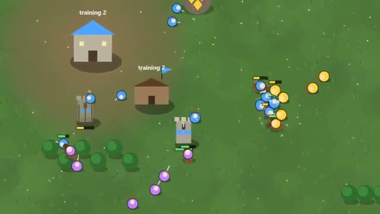

# Mini RTS

Gather, build, train an army. Last base standing wins. A multiplayer starter game from [Multiplayer Agent](https://multiplayeragent.com): 2D, versus, 2–4 players, with bots that run every base nobody plays.

## How it plays

Workers dig gold and chop wood; spend it on a barracks, towers and three kinds of soldiers. Spearmen beat riders, riders beat archers, archers beat spearmen: build the right army and destroy the other Town Halls.

Four bases start in the corners of the map, with a rich gold mine in the middle. Bots leave everyone alone for the first two and a half minutes, then attack in growing waves. After ten minutes the strongest base wins.

**Controls:** Click or drag a box to select, right-click to move, attack or gather, WASD to look around; touch: tap to select, tap the map to send, drag to look around. Number keys use the panel's buttons, Space selects your army.

## Make it yours in the Game Builder

Open the [Game Builder](https://multiplayeragent.com), choose **Start from a starter game** and pick Mini RTS. It opens as version 1 in your studio, ready to play and publish. Then ask for changes, for example:

- Make it a space war with ships and asteroid mining
- Add a fourth unit, a catapult that's great against buildings
- Hide the map until your units have seen it

## Run it yourself

1. Get a free publishable key (`pk_…`) at [multiplayeragent.com](https://multiplayeragent.com).
2. In `index.html`, put it in place of `pk_REPLACE_ME` in the `MP_CONNECT` block.
3. Open `index.html` in a browser. No build step and no server needed.

Without a key it still runs, offline against bots.

## How it is built

- One `index.html`. The comment at the top of the script maps the code and explains the multiplayer.
- **Leaderboard:** The most enemy units and buildings each player's base destroyed in a match.
- **Bots:** Bots run every base nobody plays: they build up, counter your army and attack in waves.
- **Host-run rules:** The host's browser runs every unit and checks every order; if it leaves, the next player takes over.
- **Live sync:** Everyone sees the same units moving and fighting.
- `?attract` runs it offline with bots only. The preview video is recorded from it.

## License

MIT.
